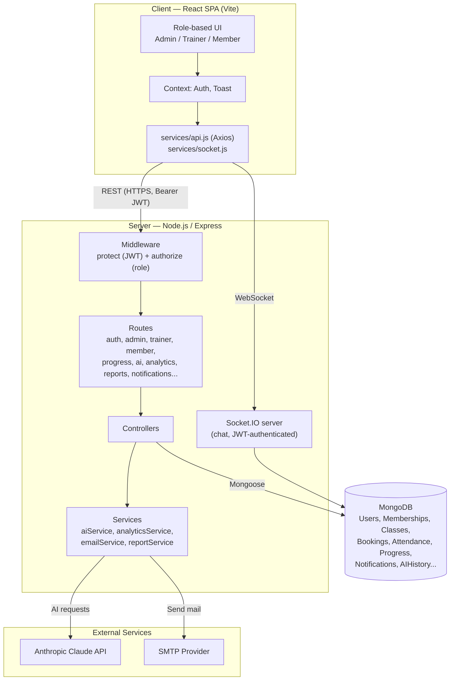

# Presentation & Viva Preparation — FitZone

## 1. PPT Structure (13 slides)

| Slide | Title | Content notes |
|---|---|---|
| 1 | **Project Title** | "FitZone — Gym Membership Management System"; your name/team, institution, guide name, date |
| 2 | **Introduction** | One-paragraph summary from `PROJECT_REPORT.md` → Chapter 1 — what the system is, MERN stack, three roles, headline features (progress tracking, AI assistant, analytics) |
| 3 | **Problem Statement** | Chapter 2 — manual/spreadsheet-based gym management: no single source of truth, no member self-service, no structured progress tracking, no business visibility, no role separation |
| 4 | **Objectives** | Chapter 3 — pick the top 5–6 of the 10 listed (role-based security, membership lifecycle, progress tracking with approval, AI guidance, analytics, unified notifications) |
| 5 | **Technology Stack** | React 19, React Router, Vite, Tailwind CSS, Framer Motion, Chart.js — Node.js, Express 5, MongoDB/Mongoose, JWT, Socket.IO, Claude AI — shown as a two-column frontend/backend stack diagram |
| 6 | **System Architecture** | The Frontend → Backend API → Database diagram (Section 3 below) — mention the AI/Email as optional external services |
| 7 | **User Roles** | Admin / Trainer / Member table from `README.md` → User Roles — emphasize this is enforced server-side, not just hidden UI |
| 8 | **Main Features** | Bulleted highlights per role from `README.md` → Features — keep to ~2 lines per role |
| 9 | **Screenshots** | 3–4 screenshots: Login, a dashboard (pick the most visual one — Admin Analytics or Member Progress), the AI Assistant chat, a generated PDF/Excel report |
| 10 | **Database Design** | The ER diagram (Section 4 below) — call out the single `User` collection with role-based fields as a deliberate design choice |
| 11 | **Testing** | Summary from `TESTING_AND_SECURITY_REPORT.md` — live functional testing across every role/module, plus the final-audit finding & fix (privilege-escalation bug caught and closed) |
| 12 | **Future Scope** | Chapter 13 of the project report — real payment gateway, mobile app, multi-branch support, push notifications, automated test suite |
| 13 | **Conclusion** | Chapter 14 — server-enforced security + data ownership scoping as the core engineering takeaway; thank you / Q&A |

## 2. Demo Flow (live walkthrough script)

Run backend (`npm run dev` in `server/`) and frontend (`npm run dev` in `client/`) beforehand. Suggested order, ~8–10 minutes:

1. **Landing page** → show public marketing page, then Register a new member account live.
2. **Member dashboard** → point out the summary cards (membership status, today's workout, notifications).
3. **Browse & purchase a membership plan** → complete the mock payment → show the payment receipt/history.
4. **Book a class** → show seat count decrement; open a second browser/incognito as the class's **trainer** to show the trainer got a "New Class Booking" notification (bell icon).
5. **QR attendance** → show the member's personal QR code; switch to **admin**, scan/check-in via the code (or simulate via the admin attendance page).
6. **Progress tracking (member)** → log a weight entry with a photo, show the live BMI calculation, chart, and the "pending" status.
7. **Progress approval (trainer)** → switch to trainer, open Progress Approval, show the before/after comparison against the member's previous entry, approve it with feedback — switch back to member to show the notification and status change.
8. **AI Fitness Assistant (member)** → ask the chatbot a question live ("what should I eat to lose weight?"), then generate a workout recommendation and show the structured output (weekly schedule, tips).
9. **Admin Analytics** → show the revenue/membership-growth/attendance charts and the popular-classes/trainer-performance charts.
10. **Admin Reports** → filter by date range, download a PDF and an Excel report live, open the downloaded file to prove it's real data.
11. **Notifications** → click the bell icon in the Topbar as any role, show unread badge, mark-as-read, delete.
12. **Close** — briefly show the folder structure / `README.md` if asked about setup.

**Fallback if live AI/email isn't configured:** mention explicitly that the AI assistant requires an `ANTHROPIC_API_KEY` and email requires `SMTP_*` env vars — both degrade gracefully (a clear message, not a crash) when unset, which is itself worth mentioning as a design decision (fail gracefully, don't break the app for missing optional config).

## 3. Architecture Diagram



## 4. ER Diagram

```mermaid
erDiagram
    USER ||--o{ MEMBERSHIP : has
    USER ||--o{ PAYMENT : makes
    USER ||--o{ BOOKING : books
    USER ||--o{ ATTENDANCE : checks_in
    USER ||--o{ PROGRESSLOG : submits
    USER ||--o{ GOAL : sets
    USER ||--o{ NOTIFICATION : receives
    USER ||--o{ CLASS : "teaches (trainer)"
    USER ||--o{ WORKOUTPLAN : "assigned (member/trainer)"
    USER ||--o{ DIETPLAN : "assigned (member/trainer)"
    USER ||--o{ AIHISTORY : generates
    USER }o--o{ USER : "assignedTrainer (member -> trainer)"

    MEMBERSHIPPLAN ||--o{ MEMBERSHIP : "purchased as"
    MEMBERSHIPPLAN ||--o{ PAYMENT : "paid for"
    MEMBERSHIP ||--o{ PAYMENT : "paid via"

    CLASS ||--o{ BOOKING : "booked by members"

    USER {
        ObjectId _id
        string name
        string email
        string password
        string role
        ObjectId assignedTrainer
        string status
    }
    MEMBERSHIPPLAN {
        ObjectId _id
        string name
        number price
        string duration
    }
    MEMBERSHIP {
        ObjectId _id
        ObjectId member
        ObjectId plan
        date startDate
        date endDate
        string status
    }
    PAYMENT {
        ObjectId _id
        ObjectId member
        ObjectId plan
        number amount
        string transactionId
        string paymentStatus
    }
    CLASS {
        ObjectId _id
        string title
        ObjectId trainer
        date date
        number capacity
        number bookedSeats
    }
    BOOKING {
        ObjectId _id
        ObjectId member
        ObjectId class
        string status
    }
    ATTENDANCE {
        ObjectId _id
        ObjectId member
        string date
        string status
    }
    PROGRESSLOG {
        ObjectId _id
        ObjectId member
        ObjectId trainer
        number weight
        number bmi
        string progressImage
        string status
        ObjectId approvedBy
    }
    GOAL {
        ObjectId _id
        ObjectId member
        string category
        number targetWeight
        string status
    }
    NOTIFICATION {
        ObjectId _id
        ObjectId user
        string title
        string message
        boolean read
    }
    AIHISTORY {
        ObjectId _id
        ObjectId user
        string type
        object input
        object response
    }
```

## 5. API Explanation (how to talk about it in a viva)

The API follows a consistent REST pattern across ~13 route files mounted in `server/app.js`:

```
/api/auth          register, login, me
/api/admin         members, trainers, plans, memberships, attendance, stats
/api/admin/analytics  membership, revenue, classes, attendance, overview
/api/admin/reports    pdf, excel (query: type, from, to)
/api/trainer       profile, members, exercises, workout-plans, diet-plans,
                    videos, progress, updates, attendance
/api/member        dashboard, profile, membership, plans, workout-plan,
                    diet-plan, attendance, notifications, goal
/api/progress      submit/update/delete own entries, BMI calculator
/api/classes       list/create/update/delete, /:id/members
/api/bookings      book, cancel, my
/api/payment       make payment, history, receipt
/api/ai            workout/diet recommendation, bmi-analysis,
                    progress-prediction, chat, rule-chat, history
/api/notifications get, unread-count, mark-read, mark-all-read,
                    delete, create (admin/trainer only)
/api/chat          get messages, send, mark read, unread count
```

Every route (except `/register`, `/login`, `/health`) passes through two middleware layers:
1. **`protect`** — verifies the `Authorization: Bearer <token>` JWT, loads `req.user` from MongoDB
2. **`authorize(...roles)`** — rejects the request with `403` if `req.user.role` isn't in the allowed list

Beyond role checks, most controllers add a second layer of **ownership scoping** — e.g. a trainer's `listProgress` query is always `ProgressLog.find({ trainer: req.user._id })`, so even a valid trainer token can never see another trainer's members' data. This is the detail worth emphasizing in a viva: **role check ≠ data isolation**, and this system implements both.

## 6. Likely Viva Questions & Answers

**Q: What was the most significant bug you found in this project, and how did you find it?**
A: During the final Phase-13 audit, testing whether the public `/api/auth/register` endpoint honored a client-supplied `role` field — it did, and the registration form even had a UI dropdown offering "Admin" as a self-signup option. Anyone could become an administrator with one unauthenticated request. It wasn't caught earlier because prior testing was feature-focused (does registration work?) rather than adversarial (can registration be misused?). The fix: the backend now hardcodes `role: 'member'` on every public registration regardless of what the client sends, and the role selector was removed from the UI entirely — trainer/admin accounts are only ever created by an existing admin. The lesson: functional testing proves a feature works; a security audit has to actively try to break the system's own assumptions, not just confirm the happy path.

**Q: Why MongoDB instead of a relational database?**
A: The data is naturally document-shaped per role (a member's profile, progress logs, bookings) and relationships are shallow (mostly one level via ObjectId refs). MongoDB's flexible schema also made it easy to add fields incrementally across development phases (e.g. adding `chest`/`waist`/`arms`/`thighs` to `ProgressLog` later) without migrations.

**Q: How is a trainer prevented from seeing another trainer's members?**
A: Every trainer-facing query is scoped server-side by `req.user._id` (from the verified JWT), not by a client-supplied ID — e.g. `User.find({ assignedTrainer: req.user._id })`. This can't be bypassed by the client because the trainer's own ID is the only identity the server trusts.

**Q: How are passwords protected?**
A: Hashed with bcrypt (`bcryptjs`, salt rounds via `bcrypt.genSalt(10)`) in a Mongoose pre-save hook; the raw password is never stored, and the field has `select: false` so it's excluded from queries by default unless explicitly requested (login).

**Q: What happens if the AI service isn't configured?**
A: `ANTHROPIC_API_KEY` is optional. If missing, `aiService` returns a controlled `503 AI service is not configured` instead of crashing — verified via testing. The rule-based chatbot widget still works with zero configuration since it doesn't call the AI API at all.

**Q: How do you prevent brute-force login attempts?**
A: `express-rate-limit` caps `/api/auth/login` and `/api/auth/register` at 10 requests per 15 minutes per IP; AI endpoints are separately capped at 30 requests per 15 minutes to control cost/abuse.

**Q: How is the uploaded progress photo secured?**
A: Multer validates MIME type (JPEG/PNG/WEBP only) and rejects anything else with a `400`, enforces a 5MB size limit, and stores files with a server-generated filename (`<userId>-<timestamp>.<ext>`) rather than trusting the client-supplied filename.

**Q: Why does the notification system use one shared collection/API instead of one per role?**
A: A `Notification` is conceptually the same object (`user`, `title`, `message`, `type`, `read`) regardless of who receives it — admin broadcasts, trainer alerts, and member alerts all reuse the same model and the same `/api/notifications` CRUD API, avoiding three near-identical parallel implementations.

**Q: How does the "before/after" comparison work for progress photos?**
A: The member's progress entries are fetched chronologically; the earliest and latest entries that have an attached photo are used as the "before" and "after" images, rendered with a draggable comparison slider on the frontend.

**Q: What's the biggest performance optimization you made?**
A: Route-based code splitting (`React.lazy` per page) — the initial JS bundle was a single ~857KB chunk containing every page for all three roles; after splitting, the main vendor chunk dropped to ~424KB and each page loads its own small chunk on demand. Backend-side, indexes were added on every field used as a filter in a hot query path (notification polling, trainer-scoped lookups, revenue-by-date aggregation) rather than relying on unindexed collection scans.

**Q: How would you scale this for multiple gym branches?**
A: Add a `Branch`/`Gym` collection and a `branch` reference on `User`, `Class`, and `Membership`; scope every admin query by the admin's own branch (same pattern already used for trainer→member scoping) — this is called out explicitly in Future Scope.
